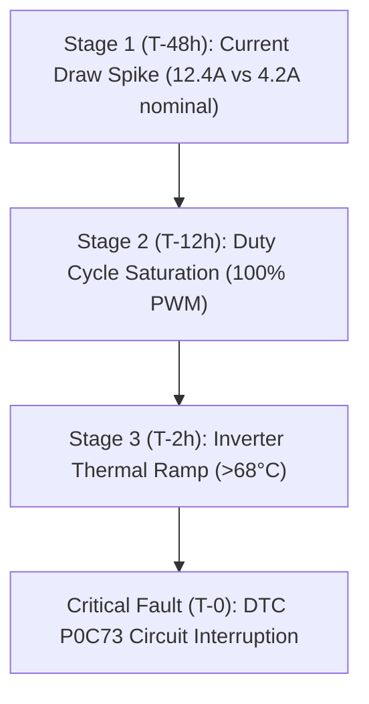

# Case Study 6: Diagnostic Telemetry Analysis for Cooling Pump Failure

## Problem Statement
The driver inquires: *"Were there any warning signs before the cooling pump failure?"*

## Root Cause & Warning Sequence
Analysis of high-frequency 10 Hz telemetry prior to DTC `P0C73` (Motor Inverter Coolant Pump Control Circuit Low) reveals a progressive 3-stage mechanical and thermal decoupling:

### 1. Electrical Resistance & Current Spike (T-48 hours)
- **Signal**: `auxiliary_current_a` / `pump_current_a`
- **Telemetry**: Current escalated from normal 4.2 A to 12.4 A, indicating rotor binding or mechanical impeller friction.

### 2. Duty Cycle Saturation (T-12 hours)
- **Signal**: `coolant_pump_duty_percent`
- **Telemetry**: Thermal controller commanded 100% continuous pump duty despite mild ambient temperatures (24°C).

### 3. Thermal Decoupling Ramp (T-2 hours)
- **Signal**: `inverter_temp_c` vs `coolant_temp_c`
- **Telemetry**: Inverter temperature rapidly diverged from coolant temperature, crossing the 68°C derating threshold due to zero fluid circulation.

## Predictive Defense Strategy
VehicleGPT flags any persistent >85% coolant pump duty cycle paired with temperature divergence as an early pre-fault condition, allowing preventative servicing prior to roadside breakdown.
